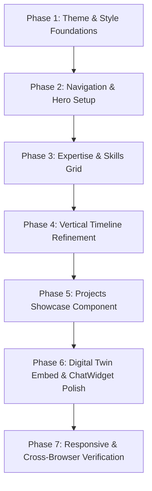

# Portfolio Redesign & Digital Twin Integration Plan

> **Objective:** Redesign Yousef Alsayed's developer portfolio to adopt the clean, modular aesthetic of [react-portfolio-template](https://github.com/yujisatojr/react-portfolio-template) while preserving and highlighting the entire **AI Digital Twin** architecture.

---

## 1. Core Principles & Preservation Strategy

### 1.1 Digital Twin Preservation (Non-Negotiable)
The Digital Twin is the centerpiece of this project. Under no circumstances will backend logic, persona context, or frontend interactivity be degraded:
* **Backend Systems Maintained:**
  * FastAPI server (`backend/server.py`), including `/chat`, `/history`, and session management.
  * AWS Lambda deployment artifacts (`lambda_handler.py`, Terraform definitions).
  * Persona knowledge base in `backend/data/` (`facts.json`, `summary.txt`, `style.txt`, `me.txt`, LinkedIn context).
* **Frontend Digital Twin Features:**
  * Keep the existing floating interactive `ChatWidget.tsx` available across the entire site.
  * Add a dedicated on-page **"Interactive Digital Twin"** section in the main layout, allowing visitors to chat with Yousef's AI without needing to open the pop-up modal.
  * Update chat UI colors to respond seamlessly to both Light and Dark modes.

---

## 2. Visual Architecture & Design Language (from `react-portfolio-template`)

| Design Element | Template Specification | Next.js / Tailwind Adaptation |
| :--- | :--- | :--- |
| **Dark Theme (Default)** | `#0d1116` midnight canvas, crisp white text, muted slate metadata | Dark mode styles using `#0d1116` background and `#161b22` card containers |
| **Light Theme** | `#f8f9fa` off-white canvas, dark slate text, soft drop shadows | Clean light mode styles using `#f8f9fa` canvas and `#ffffff` card containers |
| **Accent & Interactivity** | Violet / Indigo hover tone (`#5000ca` / `#6366f1`) | Dynamic transition hover states on buttons, links, and card borders |
| **Chips / Tech Badges** | Rounded pill badges (MUI Chip style) with subtle background tints | Custom `.tech-chip` utility with light/dark contrast |
| **Project Zoom** | Subtle card scale & zoom on image container hover | Smooth CSS transform `group-hover:scale-105` transition |
| **Timeline** | Vertical alternating timeline with milestone dots | Clean timeline component supporting mobile and desktop layouts |

---

## 3. Site Layout & Component Breakdown

```
App Layout (page.tsx)
 ├── 1. Navbar (Sticky header, section links, theme toggle, mobile drawer)
 ├── 2. Hero / Main (Avatar, title, bio, quick CTAs, social links)
 ├── 3. Expertise (3 domain columns: AI & Agents, Backend Systems, Mechatronics & Cloud)
 ├── 4. Experience / History (Chronological vertical timeline)
 ├── 5. Projects Showcase (Project cards with tags, previews, live/code links)
 ├── 6. Interactive Digital Twin Section (Full embedded chat interface on the page)
 ├── 7. Contact & Footer (Direct message CTA, contact info, social links)
 └── Floating ChatWidget (Always accessible in bottom-right corner)
```

---

### Detailed Component Specifications

### 2.1 Navigation Bar (`frontend/components/Navbar.tsx`)
* **Features:**
  * Clean fixed header with glassmorphism or solid `#0d1116` / `#f8f9fa` background on scroll.
  * Navigation items: `About`, `Expertise`, `History`, `Projects`, `Digital Twin`, `Contact`.
  * Theme switcher button with animated Moon/Sun icon toggle.
  * Responsive slide-out mobile drawer menu.

### 2.2 Hero / Main Section (`frontend/components/Hero.tsx`)
* **Content:**
  * Profile avatar image (`/yousef.jpg`) with subtle glow and border.
  * Available status badge: *"Available for opportunities"*.
  * Name: **Yousef Alsayed**.
  * Role: **AI Software Engineer & Mechatronics Graduate**.
  * Bio: Bridging LLMs, agentic workflows, backend architecture, and robotics.
  * Primary Action: **"Talk to My Digital Twin"** (scrolls to twin section or opens widget).
  * Social Links: LinkedIn, GitHub, Email.

### 2.3 Expertise Section (`frontend/components/Expertise.tsx`)
Mirrors the 3-column card structure of the template:
1. **Generative AI & Autonomous Agents**
   * *Description:* Agentic workflows, RAG pipelines, RLHF evaluation, and LLM orchestration.
   * *Chips:* `OpenAI`, `Groq`, `LangChain`, `LlamaIndex`, `RLHF`, `Prompt Engineering`, `Hugging Face`.
2. **Backend Engineering & Scalable APIs**
   * *Description:* Production Python services, high-concurrency APIs, and microservice containerization.
   * *Chips:* `Python`, `FastAPI`, `Docker`, `PostgreSQL`, `REST APIs`, `Linux`, `Git`, `CI/CD`.
3. **Cloud Architecture & Mechatronics**
   * *Description:* Serverless cloud pipelines alongside physical automation and robotics control.
   * *Chips:* `AWS Lambda`, `S3`, `API Gateway`, `CloudFront`, `Terraform`, `Siemens PLC`, `Robotics`.

### 2.4 History / Timeline Section (`frontend/components/Timeline.tsx`)
* **Entries:**
  1. **Arche Robotics** (Aug 2026 – Present) — *Artificial Intelligence Intern* (Istanbul, Türkiye)
  2. **iSchool** (May 2026 – Present) — *English-Speaking Programming Instructor* (Cairo, Egypt)
  3. **Egyptian Armed Forces Engineering Authority** (Jan 2025 – Mar 2026) — *IT Help Desk (Military Service)*
  4. **Outlier** (Nov 2024 – Jan 2025) — *AI Software Engineer (RLHF & Model Evaluation)*
  5. **Misr University for Science and Technology (MUST)** (2019 – 2024) — *B.Sc. Mechatronics, Robotics & Automation*

### 2.5 Projects Showcase Section (`frontend/components/Projects.tsx`)
* Card layout matching the template's project section:
  1. **Yousef's Digital Twin Platform**
     * Real-time conversational AI twin powered by FastAPI, OpenAI/Groq, AWS serverless, and Next.js.
  2. **Automated AI Evaluation & Reasoning Pipeline**
     * RLHF benchmarking suite for assessing LLM logic, consistency, and alignment.
  3. **Industrial Automation & PLC Controller**
     * Control systems architecture designed for Siemens S7-1200/1500 and CNC machines.
  4. **Filmate AI / Semantic Search Engine**
     * Vector search and recommendation engine powered by LLMs and vector embeddings.

### 2.6 Digital Twin Embedded Section (`frontend/components/TwinSection.tsx`)
* An on-page terminal / conversational console showcasing the twin in action right inside the page flow:
  * Chat prompt suggestions (e.g. *"Tell me about your AI experience"*, *"What was your role at Arche Robotics?"*, *"What technologies do you use?"*).
  * Direct streaming conversation with the live FastAPI backend.
  * Clear indicator that the user is interacting with an AI representation trained on Yousef's verified profile data.

### 2.7 Floating Chat Widget (`frontend/components/ChatWidget.tsx`)
* Retained in full so visitors browsing any part of the site can quickly pop open the chat drawer.
* Styled to match both light and dark modes with sleek animations.

### 2.8 Footer & Contact (`frontend/components/Footer.tsx`)
* Quick contact form or direct one-click email button (`yousefabuelkhear@gmail.com`).
* Links to LinkedIn, GitHub, and CV download.
* Copyright and tech stack credits.

---

## 4. Phased Implementation Roadmap



### Execution Details:
1. **Phase 1: CSS Tokens & Theme Engine**
   * Update [app/globals.css](file:///d:/YousefAlsayedDigitalTwin/frontend/app/globals.css) with `#0d1116` dark & `#f8f9fa` light variables.
   * Add simple React Theme Context or client hook for switching between dark and light modes.
2. **Phase 2: Header & Main View**
   * Rebuild [Navbar.tsx](file:///d:/YousefAlsayedDigitalTwin/frontend/components/Navbar.tsx) with template layout + mobile drawer.
   * Refactor [Hero.tsx](file:///d:/YousefAlsayedDigitalTwin/frontend/components/Hero.tsx) to match the template's hero section.
3. **Phase 3: Expertise Grid**
   * Build `frontend/components/Expertise.tsx` using the 3-category layout with pill chips.
4. **Phase 4: Experience Timeline**
   * Refactor [Timeline.tsx](file:///d:/YousefAlsayedDigitalTwin/frontend/components/Timeline.tsx) to use template-style card containers and alternating connector lines.
5. **Phase 5: Projects Grid**
   * Create `frontend/components/Projects.tsx` featuring Yousef's real projects with hover zoom animation.
6. **Phase 6: Digital Twin Integration**
   * Enhance [ChatWidget.tsx](file:///d:/YousefAlsayedDigitalTwin/frontend/components/ChatWidget.tsx) and create an embedded twin section (`TwinSection.tsx`).
   * Verify all API calls connect to `NEXT_PUBLIC_API_URL` (`http://localhost:8000` or production URL).
7. **Phase 7: Testing & Verification**
   * Verify responsiveness across mobile, tablet, and desktop viewports.
   * Test dark and light mode toggles.
   * Verify chat connectivity and session memory.

---

## 5. Risk Assessment & Safeguards

| Risk | Mitigation |
| :--- | :--- |
| **Breaking chat API communication** | Keep all existing request/response formats (`{ message, session_id }`), fallback URLs, and headers intact. |
| **Styling conflicts with Next.js 16 / Tailwind v4** | Use clean Tailwind utility classes and CSS variables without importing conflicting external SCSS libraries. |
| **Loss of profile accuracy** | Strictly draw details directly from `backend/data/facts.json` and `backend/data/summary.txt`. |
