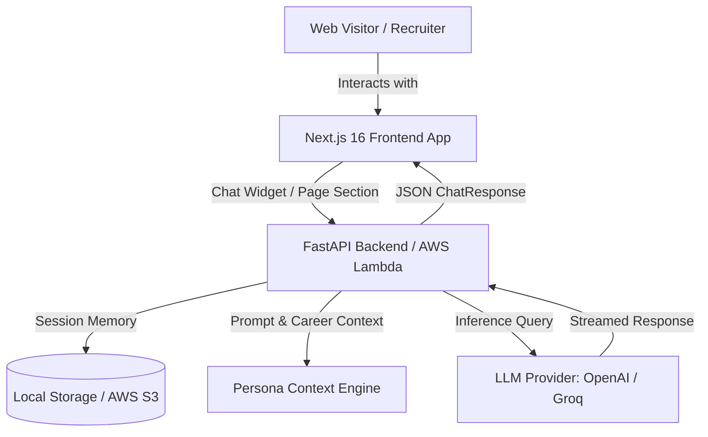

# Yousef Alsayed — AI Digital Twin & Full-Stack Portfolio

[](https://nextjs.org/)
[](https://react.dev/)
[](https://fastapi.tiangolo.com/)
[](https://www.python.org/)
[](https://tailwindcss.com/)
[](https://aws.amazon.com/)
[](https://www.terraform.io/)

A modern, full-stack developer portfolio integrated with an **autonomous AI Digital Twin**. This repository pairs a responsive, high-performance **Next.js 16** frontend with a **FastAPI** backend that acts as Yousef's virtual twin — answering technical questions, discussing project history, and interacting with recruiters and developers in real-time.

---

## 🌟 Key Features

* **🤖 Autonomous AI Digital Twin**:
  * Real-time conversational AI trained on Yousef's verified career history, technical expertise, and engineering philosophy.
  * Multi-provider LLM support (**OpenAI GPT-4o-mini** and **Groq OSS models**).
  * Session-based memory with persistence to **AWS S3** or local storage.
  * Available both as an on-page interactive section and an omnipresent floating chat widget.

* **🎨 Modern UI & Dual Themes**:
  * Clean, developer-focused aesthetic inspired by modern portfolio design systems.
  * Seamless **Dark Mode** (`#0d1116` midnight) and **Light Mode** (`#f8f9fa` canvas) with animated theme toggle.
  * Rich micro-animations, skill chips, expandable project cards, and chronological experience timeline.

* **☁️ Cloud & Serverless Ready**:
  * Backend deploys as an **AWS Lambda** function via Mangum with API Gateway and S3 bucket storage.
  * Infrastructure as Code configured with **Terraform**.
  * Automated CI/CD workflows powered by **GitHub Actions**.

---

## 🏗️ System Architecture



---

## 📁 Repository Structure

```text
YousefAlsayed-DigitalTwin/
├── .github/
│   └── workflows/
│       ├── deploy-aws.yml        # CI/CD: Automated AWS Lambda deployment
│       └── backup-check.yml      # CI/CD: Health & backup verification
├── backend/
│   ├── data/                     # Persona context, resume, facts, and profile data
│   │   ├── facts.json            # Structured career and skill facts
│   │   ├── summary.txt           # Executive career summary
│   │   └── style.txt             # Conversational style guidelines
│   ├── context.py                # Context loader and dynamic prompt builder
│   ├── server.py                 # FastAPI application and chat endpoints
│   ├── lambda_handler.py         # AWS Lambda entrypoint (Mangum)
│   ├── requirements.txt          # Python dependencies
│   └── Procfile                  # Alternative deployment configuration
├── frontend/
│   ├── app/                      # Next.js App Router (layout, page, globals.css)
│   ├── components/               # React UI components
│   │   ├── Navbar.tsx            # Navigation bar & theme switch
│   │   ├── Hero.tsx              # Hero introduction & quick links
│   │   ├── About.tsx             # Background & education
│   │   ├── Expertise.tsx         # Domain skill cards & tech chips
│   │   ├── Timeline.tsx          # Career timeline
│   │   ├── Projects.tsx          # Interactive project showcase
│   │   ├── twin.tsx              # On-page Digital Twin chat interface
│   │   ├── ChatWidget.tsx        # Floating pop-up chat widget
│   │   ├── Contact.tsx           # Contact form & social connections
│   │   └── ThemeProvider.tsx     # Theme state management
│   ├── public/                   # Static assets, images, and avatar
│   └── package.json              # Frontend scripts & dependencies
├── terraform/                    # Infrastructure as Code definitions
│   ├── bootstrap/                # AWS resource bootstrap
│   ├── variables.tf              # Terraform input variables
│   └── versions.tf               # Terraform AWS provider config
├── .gitignore                    # Ignored artifacts & environment files
├── PLAN.md                       # Architectural design plan
└── README.md                     # Repository documentation
```

---

## 🚀 Getting Started

### Prerequisites

* **Node.js** 20.x or higher
* **Python** 3.11 or higher
* **Git**
* OpenAI API Key or Groq API Key

---

### 1. Backend Setup

1. Navigate to the backend folder:
   ```bash
   cd backend
   ```

2. Create and activate a Python virtual environment:
   ```bash
   # Windows
   python -m venv .venv
   .venv\Scripts\activate

   # Linux / macOS
   python3 -m venv .venv
   source .venv/bin/activate
   ```

3. Install dependencies:
   ```bash
   pip install -r requirements.txt
   ```

4. Create an environment configuration file:
   ```bash
   cp .env.example .env
   ```
   Add your API keys to `backend/.env`:
   ```env
   OPENAI_API_KEY=your_openai_api_key_here
   # OR
   GROQ_API_KEY=your_groq_api_key_here

   # Storage configuration
   USE_S3=false
   MEMORY_DIR=../memory
   CORS_ORIGINS=http://localhost:3000
   ```

5. Run the FastAPI development server:
   ```bash
   python server.py
   # Or using uvicorn:
   uvicorn server:app --reload --port 8000
   ```
   The API will be accessible at `http://localhost:8000` (docs at `http://localhost:8000/docs`).

---

### 2. Frontend Setup

1. Navigate to the frontend directory:
   ```bash
   cd frontend
   ```

2. Install dependencies:
   ```bash
   npm install
   ```

3. Configure environment variables (optional for local API override):
   ```env
   NEXT_PUBLIC_API_URL=http://localhost:8000
   ```

4. Launch the Next.js development server:
   ```bash
   npm run dev
   ```
   Open [http://localhost:3000](http://localhost:3000) in your browser.

---

## 📡 API Endpoints

| Method | Endpoint | Description |
| :--- | :--- | :--- |
| `GET` | `/` | API status and memory configuration details |
| `GET` | `/health` | Health check endpoint |
| `POST` | `/chat` | Send a message to the AI Digital Twin and receive a response |
| `GET` | `/conversation/{session_id}` | Retrieve chat history for an active session |

#### Sample `/chat` Request
```json
{
  "message": "What is Yousef's experience with Autonomous Agents and FastAPI?",
  "session_id": "optional-uuid"
}
```

---

## ☁️ Deployment

### Frontend Deployment
The frontend is optimized for deployment on [Vercel](https://vercel.com) or AWS Amplify:
```bash
cd frontend
npm run build
```

### Backend Deployment (AWS Serverless)
1. Package the FastAPI application for Lambda:
   ```bash
   pip install -t lambda-package -r requirements.txt
   cp server.py context.py lambda_handler.py lambda-package/
   cp -r data lambda-package/
   cd lambda-package && zip -r ../lambda-deployment.zip .
   ```
2. Provision resources and deploy using Terraform:
   ```bash
   cd terraform
   terraform init
   terraform apply
   ```

---

## 👤 Author

**Yousef Alsayed Abdelfattah**
* **Title:** AI Software Engineer & Mechatronics Graduate
* **LinkedIn:** [linkedin.com/in/yousef-alsayed-abdelfattah](https://www.linkedin.com/in/yousef-alsayed-abdelfattah)
* **GitHub:** [@yousefattaff](https://github.com/yousefattaff)
* **Email:** yousefabuelkhear@gmail.com

---

## 📄 License

This project is licensed under the MIT License — feel free to explore, customize, and build your own Digital Twin!
