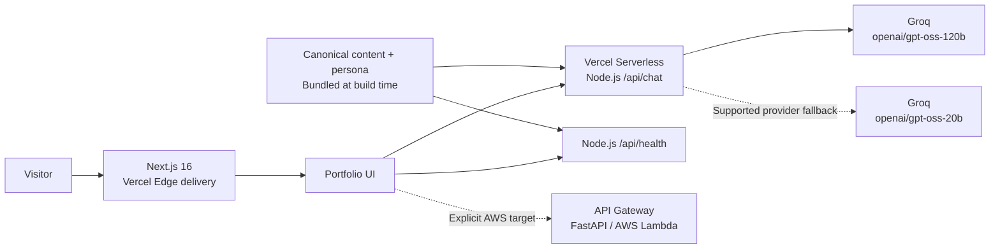

# Yousef Alsayed — AI Digital Twin

**An AI solutions portfolio you can explore, query, and talk to.**

[](https://yousefalsayed.me)
[](https://nextjs.org)
[](https://react.dev)
[](https://vercel.com)
[](https://console.groq.com)
[](https://www.typescriptlang.org)
[](https://tailwindcss.com)

Built with Next.js 16, React 19, and TypeScript, this portfolio presents Yousef's AI solution development, agent workflows, RAG projects, and robotics experience. Its Digital Twin answers from verified career documents and an authentic conversational persona through a native Vercel serverless API.

[Explore the live portfolio](https://yousefalsayed.me) · [Deployment guide](DEPLOYMENT_PLAN.md) · [Release review](docs/RELEASE_REVIEW.md)

## Core features

- **AI Digital Twin.** Grounded in career facts, resume content, project narratives, and tone guidelines. Bounded conversation history and retrieval topics support follow-up questions across fresh serverless instances. Groq uses `openai/gpt-oss-120b`, with `openai/gpt-oss-20b` for supported provider fallback conditions.
- **Obsidian & Titanium Stealth Design System.** An obsidian canvas, frosted zinc panels, titanium text, and breathing emerald status indicators. Responsive galleries, video posters, defined media proportions, and reduced-motion styles keep the interface steady.
- **Multi-cloud fallback ready.** Vercel serves the portfolio and native Twin together. The optional FastAPI/Mangum backend supports AWS Lambda and local/S3 conversation storage. Selecting the AWS target requires a verified external API and a frontend rebuild; Terraform currently supplies the state bootstrap.

## Architecture



Vercel's edge network delivers the site; the API routes execute in the **Node.js serverless runtime**. In the default Vercel mode, the browser calls same-origin `/api/chat` and `/api/health`. The Groq key stays on the server.

## Repository layout

```text
.
├── frontend/               Next.js app, components, CSS, native API, tests, media
│   ├── app/api/            Chat and configuration-health routes
│   ├── content/            Synchronized Markdown for deployment
│   ├── data/twin/          Synchronized facts and persona
│   ├── lib/                Twin service, content parsing, browser chat state
│   └── scripts/            Development, deployment, and release checks
├── content/                Canonical editable portfolio and Twin knowledge
├── backend/                Optional FastAPI / Lambda service
│   ├── data/               Persona sources and LinkedIn provenance
│   ├── terraform/          AWS provider configuration and state bootstrap
│   └── tests/              Backend and packaging regressions
├── .github/                CI, health checks, optional AWS deployment
├── docs/                   Canonical release review
└── DEPLOYMENT_PLAN.md       Vercel, environment, DNS, and AWS setup
```

Local source-media archives and private conversation storage are kept in ignored `.local/` and `backend/.memory/` directories. They are excluded from release candidates.

## Local development

Requires **Node.js 20.9+**, npm, Git, and a [Groq API key](https://console.groq.com/keys). Python is needed only for the optional external backend.

```bash
git clone https://github.com/yousefattaff/YousefAlsayed-DigitalTwin.git
cd YousefAlsayed-DigitalTwin/frontend
npm ci --include=dev
cp .env.example .env.local
```

On PowerShell, replace the last command with `Copy-Item .env.example .env.local`. Edit the ignored `.env.local`:

```dotenv
NEXT_PUBLIC_DEPLOY_TARGET=vercel
GROQ_API_KEY=your_groq_api_key_here
GROQ_MODEL=openai/gpt-oss-120b
GROQ_MODEL_FALLBACK=openai/gpt-oss-20b
```

```bash
npm run dev
```

Open [localhost:3000](http://localhost:3000). The launcher checks the server key and knowledge, then starts or reuses Next.js. Both native API routes run in that process. Restart the server after changing environment settings.

`GROQ_API_KEY` must remain server-only. Keep credentials in ignored `.env*` files or Vercel environment settings; `.env.example` is the only public environment template.

## Content workflow

Edit Markdown in root [content/](content/README.md). Public identity and links live in `profile.md`; `experience.md`, `expertise.md`, projects, and certifications provide the Twin's career knowledge. The persona sources are `backend/data/facts.json`, `summary.txt`, and `style.txt`; the LinkedIn source is `backend/data/linkedin.pdf`.

`predev` and `prebuild` synchronize these sources into `frontend/content/` and `frontend/data/twin/`. The sync removes stale bundled Markdown after a canonical document is deleted or renamed, so the deployed Twin uses current knowledge. Next.js traces the copies into both serverless functions. Run `npm run sync:content` after content edits when preparing a standalone frontend upload, and include the synchronized copies in the release.

Preserve the public navigation IDs: `about`, `skills`, `projects`, `achievements`, `contact`, and `twin`.

## Production verification

From `frontend/`:

```bash
npm test
npm run lint
npm run build
npm run release:check
npm run start
```

The release checker verifies secret/artifact exclusions, source and Git-index credentials, browser output, native API manifests, bundled knowledge, protected IDs, and referenced local assets. It runs offline and does not modify Git.

`GET /api/health` checks server configuration and loaded documents. A successful health response is distinct from a real Groq reply; exercise `POST /api/chat` and a follow-up question to verify provider connectivity.

## Deployment and release

Vercel uses root directory `frontend/`, framework `nextjs`, `npm ci --include=dev`, `npm run build`, and the framework-default output. Set the Production server-only `GROQ_API_KEY` and `NEXT_PUBLIC_DEPLOY_TARGET=vercel`, then redeploy. See [DEPLOYMENT_PLAN.md](DEPLOYMENT_PLAN.md) for the verified-project deployment helper and Namecheap records.

The optional backend uses Python 3.12+ and the frozen `uv.lock`. From the repository root:

```bash
cd backend
uv sync --frozen --no-dev
cp .env.example .env
uv run --frozen --no-dev python -m unittest discover -s tests
uv run --frozen --no-dev uvicorn server:app --reload --port 8000
```

Set the backend's own key in `.env` before serving external chat. For this mode, set `NEXT_PUBLIC_DEPLOY_TARGET=aws` and a verified `NEXT_PUBLIC_API_URL` in the frontend environment. The AWS workflow updates an existing Lambda; it does not provision application infrastructure.

From the repository root, the PowerShell release helper runs the checks, stages the intended project paths, scans the Git index again, and creates the requested commit:

```powershell
& .\.github\prepare-release.ps1
git push origin main
```
